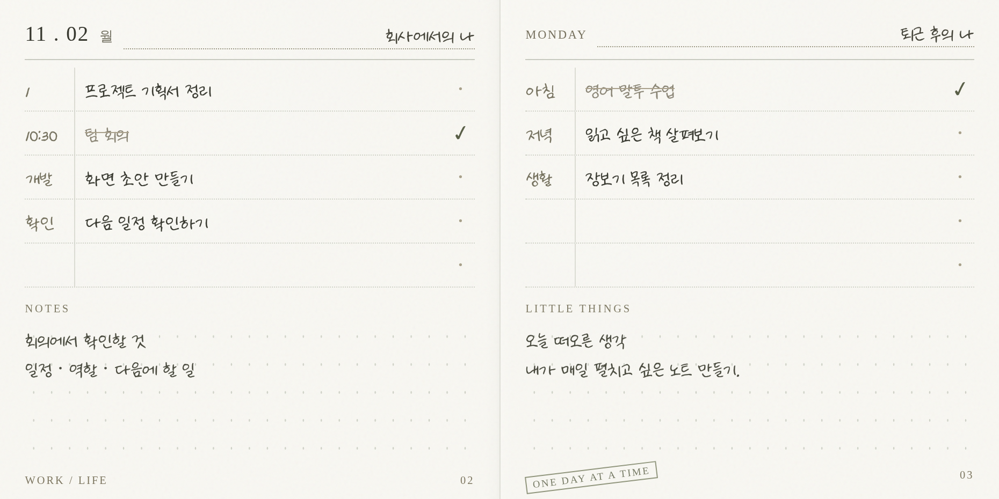

# 사각 · sagak

**펼쳐 쓰는 나의 하루.**

밝은 종이결과 손글씨로 하루를 기록하는 개인용 **macOS 전용 데스크톱 일일노트 앱**입니다.
PC에 설치해 독립된 창에서 표지를 열고, 가로로 펼친 두 페이지에 서로 다른 역할의 할 일과 메모를 나누어 적습니다.

## 디자인 시안



[글꼴·크기 설정 화면](docs/images/notebook-settings.png) · [인터랙티브 시안 원본](docs/reference/notebook-preview.html)

시각적 참고용 시안이며 실제 앱·저장 기능은 아닙니다. HTML 원본은 내려받아 브라우저에서 열 수 있습니다.

## 실행·저장 방향

- 배포 결과물은 macOS 전용 설치형 데스크톱 앱입니다.
- 화면은 익숙한 HTML/CSS/TypeScript로 구현하고, 데스크톱 실행 계층을 결합합니다.
- 확정 스택은 Tauri + React + TypeScript + Vite, 로컬 저장은 SQLite입니다. Intel·Apple Silicon 맥을 지원 대상으로 합니다.
- 브라우저 IndexedDB·PWA를 첫 버전의 실행·저장 기준으로 삼지 않습니다.
- 기록은 PC의 앱 데이터 영역에 보관하고 JSON 백업·복원을 제공합니다. 서버·로그인은 첫 버전의 필수 요건이 아닙니다.
- GPT는 사각을 실행하는 기반이 아니라, 필요해질 때 기록 요약 등 보조 기능으로 별도 검토합니다. 첫 버전에는 GPT·AI 기능을 넣지 않습니다.

## 제품 방향

- 버터색 표지에서 시작해 오늘 페이지로 이동합니다.
- 펼친 노트 전체는 **가로 2 : 세로 1** 비율을 유지합니다.
- 노란기가 적은 밝은 아이보리와 은은한 종이결을 사용합니다.
- 기본 글꼴은 **다행체**이며 글꼴·글자 크기를 선택할 수 있습니다.
- 하루에 좌우 한 쌍을 사용합니다. 기본 역할 제목은 `회사 일 / 나의 일`이며 날짜별로 수정하고 보존합니다.
- 설치 파일로 직접 설치하고 새 버전은 수동으로 업데이트합니다. 업데이트 시 기존 기록을 보존합니다.
- 긴 내용은 노트 안에서 스크롤하며, 노트를 세로로 늘리지 않습니다.

## 현재 상태

첫 로컬 기록 흐름을 구현했습니다. 버터색 표지에서 현지 날짜의 오늘 노트를 열고, 좌우 역할 제목·할 일·보조 칸·완료 상태·메모를 SQLite에 자동 저장합니다. 저장 중·완료·실패와 재시도를 표시하며 정상 종료 요청 시 남은 저장을 기다립니다. 자정이 지나면 현재 기록의 날짜를 표시하고 저장 후 오늘 페이지를 열 수 있습니다.

다행체 원본과 [저작권 안내·라이선스](public/fonts/LICENSE.txt)는 앱에 포함합니다. 기본 본문은 실제 18px이며 글꼴·크기 선택은 후속 작업입니다. 기본 창은 1240×800, 최소 창은 960×640입니다. 내용이 길면 할 일·메모 안에서 스크롤하고, 노트 전체 2:1 비율을 유지합니다.

날짜 탐색, 노트 이름·시작 화면·글꼴 설정, 항목 삭제·이동, JSON 백업·복원은 아직 구현하지 않았습니다. Intel·Apple Silicon 지원이 목표이며 현재 Apple Silicon 개발용 `.app` 빌드까지만 확인했습니다. 실제 앱 창 입력·종료·재실행, Intel, OS 재시작, 설치·업데이트, 서명·공증 검수는 남아 있습니다. [검증 기록](docs/verification/2026-11-12-first-note.md)에 범위를 구분했습니다.

## 문서

- [제품 기획서](docs/product-spec.md): 사용 흐름, 기능, 개발 단계, 미결정 사항.
- [디자인 가이드](docs/design-guide.md): 종이·비율·서체·레이아웃의 기준.
- [개발 인수인계](docs/implementation-plan.md): 첫 구현 순서와 검수 항목.
- [개발 에이전트 지침](AGENTS.md): 구현 중 지켜야 할 원칙.

## 개발 시작

macOS, Node.js 24 이상, Rust stable 1.99 이상, Xcode 명령줄 도구가 필요합니다. Rust 설치 후 새 터미널을 열거나 `source "$HOME/.cargo/env"`로 Cargo 경로를 적용합니다. [Tauri 공식 준비 안내](https://v2.tauri.app/start/prerequisites/)를 참고하세요.

```sh
npm ci
npm run tauri dev
```

데스크톱 앱을 실행하며 기록은 개발 서버나 브라우저 저장소에 보관하지 않습니다. 화면만 미리 볼 때는 `npm run dev` 후 `http://127.0.0.1:1420`을 엽니다. 브라우저 미리보기 입력은 저장되지 않습니다.

```sh
npm test
npm run typecheck
npm run build
cargo test --locked --manifest-path src-tauri/Cargo.toml
cargo fmt --manifest-path src-tauri/Cargo.toml -- --check
cargo clippy --locked --manifest-path src-tauri/Cargo.toml --all-targets -- -D warnings
npm run tauri build -- --debug --bundles app
```

형식·정적 검사 도구는 `rustup component add rustfmt clippy`로 설치합니다. 마지막 명령은 현재 Mac 아키텍처용 개발 빌드 `src-tauri/target/debug/bundle/macos/사각.app`을 만듭니다. 배포용 서명·공증·DMG를 검증한 결과물은 아닙니다. 기존 디자인 시안 워크플로와 별도로 macOS 앱 검사 CI를 추가했습니다.

## 로컬 기록

- 앱 식별자: `com.jihye.sagak`. DB: `~/Library/Application Support/com.jihye.sagak/sagak.sqlite3` (`app_data_dir` 기준).
- 스키마 v1: 날짜를 키로 좌우 페이지 전체를 JSON 스냅샷으로 저장하는 `pages` 테이블. 할 일 ID·순서·완료 여부·메모·그날의 제목을 함께 보존합니다.
- Rust만 DB에 접근합니다. 쓰기 순서를 직렬화하고 SQLite 트랜잭션이 완료된 뒤 저장 완료를 표시합니다. 중복 실행은 기존 창으로 이동합니다.
- 읽기에 실패하면 빈 기록으로 덮어쓰지 않습니다. 더 새로운 DB 버전도 초기화하지 않고 오류를 표시합니다. 하루 기록의 상한은 8MB입니다.
- 개발·앱 번들 모두 같은 기록 경로를 사용합니다. 빌드 폴더를 지워도 DB는 남습니다. 앱 데이터 폴더를 삭제하면 기록도 삭제됩니다.
- 아직 외부 백업·복원 기능이 없습니다. 강제 종료·전원 손실 시 저장 완료 전의 입력은 유실될 수 있으므로 현재 빌드는 가상 기록 검수용으로 사용합니다.

## 참고

[세일러즈 일일노트 2](https://sailors.co.kr/product/%EC%9D%BC%EC%9D%BC%EB%85%B8%ED%8A%B8-2/112/)의 역할별 기록 방식과 가로 속지를 참고했습니다.
상품 사진·브랜드 자산·고유 장식을 그대로 사용하지 않습니다.
