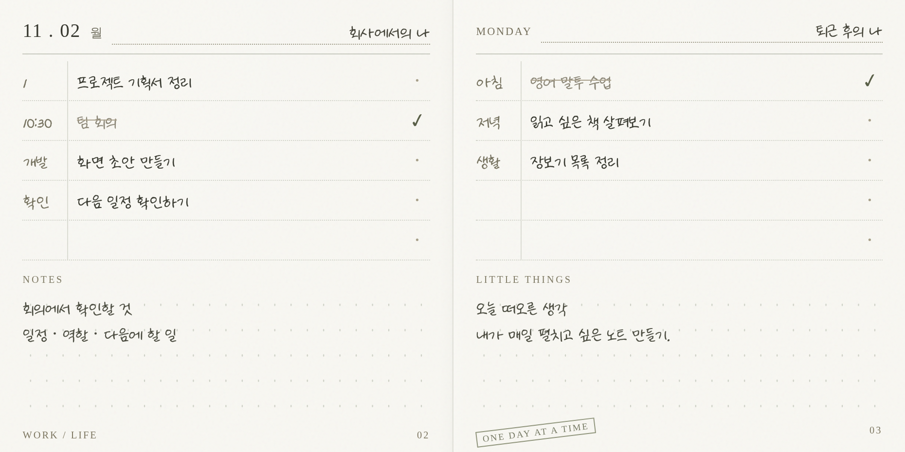
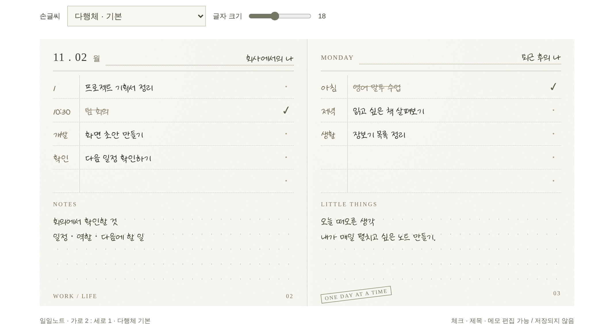

# 사각 디자인 가이드

## 최종 참고 시안

- [인터랙티브 HTML 원본](reference/notebook-preview.html): 다운로드 후 브라우저에서 열기.
- 확정한 방향: 밝은 아이보리, 다행체 기본, 전체 2:1, 회색 받침 배경 없음.
- 기록은 공개용 가상 예시입니다. 실제 데이터나 사용자 기록이 아닙니다.
- 시안은 디자인 참고용이며 컨테이너 너비 비례 글자 크기 등 임시 코드를 앱에 그대로 이식하지 않습니다.
- 이미지는 `design-preview.yml`이 원본에서 생성합니다. 저장·백업 기능은 없습니다.

## 시각적 목표

새 다이어리의 보송한 종이에 차분한 손글씨로 기록하는 느낌.
속지의 가는 선, 작은 인쇄 표기, 사용자가 쓴 내용이 중심이다.

## 확정한 기준

| 요소 | 기준 |
| --- | --- |
| 펼침면 | 전체 2:1, 좌우 두 페이지 |
| 종이 기본색 | 밝은 아이보리 `#F8F7F2` |
| 질감 | 아주 낮은 대비의 미세한 종이결 |
| 외곽 배경 | 회색 받침판 없음 |
| 그림자 | 외곽·겹친 종잇장 효과 없음. 가운데 접힘만 매우 약하게 |
| 구조 | 가는 구분선, 옅은 점선, 하단의 은은한 도트 |
| 기본 글꼴 | 다행체 |
| 글꼴 설정 | 사용자가 변경 가능 |
| 크기 설정 | 본문·보조 칸·메모에 적용. 날짜·인쇄 라벨과 분리 |

표지의 버터색과 아래 보조 색상은 최종 디자인 검토로 조정한다.

| 보조 요소 | 시작 색상 제안 |
| --- | --- |
| 글씨 | 진한 흑연색 `#494A3E` |
| 실선 | `#C9CBC1` |
| 점선 | `#D3D5CB` |
| 페이지 경계 | `#DEDED5` |

## 속지 구성

좌우 각각 위에서 아래로 역할 제목, 할 일 목록, 자유 메모, 작은 하단 표기가 놓인다.
왼쪽 상단에 날짜·요일을 표시한다. 역할 제목은 고정 분류가 아닌 사용자 입력이다.

할 일 한 줄은 자유 보조 칸, 본문, 완료 표시로 나눈다.
보조 칸에는 시간·순서·분류 등 사용자가 필요한 값을 적는다.
완료 표시는 작고 담백하게. 장식적 배지나 과한 색상 강조를 추가하지 않는다.

## 비율과 넘침

- 외곽 `aspect-ratio: 2 / 1`은 콘텐츠 길이와 관계없이 유지한다.
- 고정된 노트 내부를 제목·목록·메모·하단으로 배분한다.
- 목록과 메모 영역은 각각 줄어들 수 있도록 하고 넘치는 내용은 내부 스크롤로 접근한다.
- 기본 샘플의 메모와 하단 문구를 잘라내지 않는다. 숨김 처리로 문제를 감추지 않는다.
- 글자 크기를 높이면 가시 줄 수가 줄어도 된다. 선택한 크기를 몰래 줄여 맞추지 않는다.
- 화면 폭이 작을 때 2:1 유지와 가독성을 어떻게 함께 충족할지는 모바일 정책에서 별도 결정한다.

## 서체

- 기본: 나눔손글씨 다행체.
- 후보: 나눔바른펜, 교보 손글씨 우선아, 바른히피, 흰꼬리수리.
- 크기는 실제 CSS px 기준. 시안의 컨테이너 너비 비례 글자 크기는 제품에 그대로 적용하지 않는다.
- 최초 18px, 14~24px 조절 범위를 제안한다. 실제 기본 크기와 범위는 PC 화면에서 검토한다.
- 글꼴별 마지막 선택 크기 보존을 제안한다.
- 자간·행간과 텍스트 대비로 차분함을 만든다. 글자를 인위적으로 일그러뜨리거나 질감으로 읽기 어렵게 만들지 않는다.
- 폰트 로딩 실패 시 읽을 수 있는 대체 글꼴을 제공한다.
- 배포 전 원 제공자의 라이선스와 허용된 웹 사용 방식을 확인한다.

## 표지

버터색 표면, 작은 “사각”, 보조 문구 “펼쳐 쓰는 나의 하루.”
제목과 은은한 눌림 표현을 중심으로 한다. 통계·일정·체크리스트를 표지에 추가하지 않는다.
짧고 조용한 열림 동작을 사용하며 감소된 동작 설정을 존중한다.

## 화면 검수

대표 PC 화면, 창 축소, 모든 글꼴, 크기 범위 양 끝, 긴 한글 텍스트, 글꼴 로딩 전후를 확인한다.
종이 전체가 2:1인지, 목록·메모·하단 표기가 겹치지 않는지, 넘친 내용에 접근할 수 있는지를 함께 확인한다.
